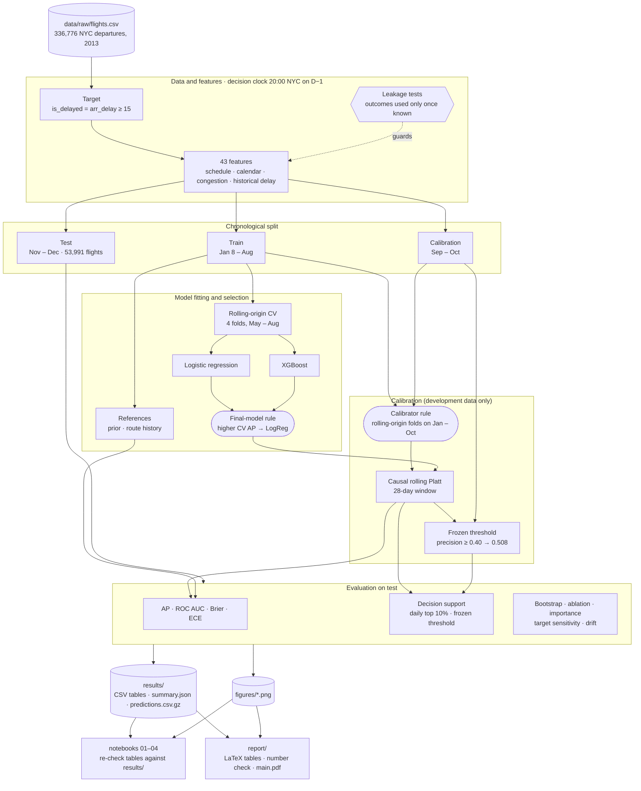

# AeroCast-AI: Day-Ahead Flight Delay Risk

**Team T49 · AML Project 21: Flight Delay Prediction and Rescheduling · Phase 1 (machine learning only)**\
*Project brief: Flight Delay Prediction via Gradient Boosting and Temporal Deep Learning*

Predict whether a flight arrives **≥ 15 min late** using only information available at **20:00 NYC on the evening before departure**.

- **Data:** [`nycflights13`](https://www.kaggle.com/datasets/mahoora00135/flights), 336,776 departures from EWR, JFK and LGA in 2013. No weather: observed weather would leak at the decision clock ([limitations](docs/limitations_and_assumptions.md)).
- **Split:** chronological, train Jan 8–Aug · calibration Sep–Oct · test Nov–Dec, with rolling-origin CV inside train. One year and three origins cannot establish cross-year generalisation.
- **Models:** logistic regression and XGBoost, against two references: the base-rate *prior* and a *route-history* heuristic.
- **Final model:** `LogReg (rolling Platt 28d, rule-selected)`, chosen by higher development CV AP (0.4714 vs 0.4500 for fixed-tree XGBoost). The 95% day-block bootstrap interval for test AP, XGBoost − LogReg, is [−0.015, +0.027]; it includes zero, so it establishes neither a difference nor equivalence.

The [8-page IEEE report](report/main.pdf) covers related work, method theory and results. Development-time test exposure is disclosed in the [development protocol](docs/development_protocol.md). A later phase adds an MLP with learned airline, origin and destination embeddings; a temporal deep-learning model is optional and needs correctly ordered flight history.

## Dataflow



## Workflow

1. **Target:** `is_delayed = arr_delay >= 15`. Cancelled and diverted flights stay in the schedule for congestion counts but are excluded from the main target; a sensitivity analysis counts them as delayed.
2. **Features:** 43 categorical, schedule, cyclic-time, calendar, congestion and historical-delay features. A flight's own actual departure/arrival times are never predictors; earlier flights' outcomes enter history only once they are known at the decision clock.
3. **Fitting and selection:** tune LogReg and XGBoost on four rolling-origin folds (May–Aug) with the same features. Fitting, CV scoring, calibration and threshold selection all enforce outcome-availability cutoffs.
4. **Calibration:** choose the calibrator on development data only. Four rolling-origin folds on Jan–Oct compare raw, static Platt, static isotonic and causal rolling Platt (28 days); the lowest mean ECE wins if it beats raw by more than 0.005. Rolling Platt is selected for both models.
5. **Evaluation and decision support:** score Nov–Dec on AP, ROC AUC, Brier, ECE and policy precision/recall, flagging the riskiest 5–20% of flights each day under explicit review-capacity assumptions. A full what-if rescheduling simulation is future work.

## Headline result

Test = Nov–Dec 2013, 53,991 flights, base rate 0.258. PR-AUC is average precision (AP). Values are rounded from [results/headline_test.csv](results/headline_test.csv); selection metadata is in [results/summary.json](results/summary.json). *Prior* and *route history* are reference rows. Lower Brier and ECE are better.

| model | calibration | pr_auc | roc_auc | brier | ece | ece_equal_mass | oracle_recall@p0.40 |
|---|---|---|---|---|---|---|---|
| Prior (base rate) | none | 0.258 | 0.500 | 0.192 | 0.007 | 0.007 | 0.000 |
| Route history | none (smoothed rate) | 0.353 | 0.621 | 0.187 | 0.037 | 0.038 | 0.244 |
| LogReg (raw) | raw | 0.393 | 0.653 | 0.181 | 0.019 | 0.022 | 0.421 |
| LogReg (rolling Platt 28d, rule-selected) | rolling Platt 28d (rule-selected) | 0.392 | 0.657 | 0.181 | 0.027 | 0.027 | 0.428 |
| LogReg (rolling Platt 28d) | rolling Platt 28d (causal) | 0.392 | 0.657 | 0.181 | 0.027 | 0.027 | 0.428 |
| XGBoost (rolling Platt 28d, rule-selected) | rolling Platt 28d (rule-selected) | 0.396 | 0.664 | 0.180 | 0.023 | 0.022 | 0.438 |
| XGBoost (rolling Platt 28d) | rolling Platt 28d (causal) | 0.396 | 0.664 | 0.180 | 0.023 | 0.022 | 0.438 |

- **Calibration (LogReg):** rolling Platt test ECE is 0.027 (December 0.050); a static Platt fit would reach 0.143 in December (base rate 33.5%). Raw scores reach 0.019 on test but lost to rolling Platt in three of four development folds, so switching to raw would select on the test set.
- **Primary policy (final model, daily top 10%):** precision 0.448, recall 0.174, lift 1.73× (prior: 0.94×).
- **Secondary policy (threshold 0.508, frozen on Sep–Oct for precision ≥ 0.40):** test precision 0.547 but recall only 0.040. A test-tuned oracle threshold would reach recall 0.428 at precision 0.400 ([threshold_vs_oracle.csv](results/threshold_vs_oracle.csv)): a fixed probability cut transfers poorly across seasons.
- **Accuracy hides ranking skill:** LogReg accuracy 0.743 / 0.731 and F1 0.075 / 0.251 (frozen threshold / daily top 10%), while predicting every flight on time already scores 74.2%. See [evaluation notes](docs/04_evaluation.md) and the [confusion matrix](figures/confusion_logreg_test.png).
- **Metric notes:** `oracle_recall@p` tunes the threshold on the evaluated labels, so it compares models and is not an operating result. `ece` uses 15 fixed-width bins; `ece_equal_mass` uses up to 15 rank bins that keep tied probabilities together ([details](docs/04_evaluation.md)). Use fixed-width ECE and Brier for calibration; low ECE alone does not imply ranking skill.

## Team and roles

Team number: **T49**.

| Member | GitHub ID | Role |
|---|---|---|
| **Nipun Patlori** | [nipun1803](https://github.com/nipun1803) | XGBoost model development; IEEE report |
| **Anushka Tyagi** | [anu-ushka](https://github.com/anu-ushka) | Logistic regression model development |
| **Omkar Hadole** | [omkar-hadole](https://github.com/omkar-hadole) | Leakage removal and feature engineering |
| **Mohan Kumar C R** | [mohan101mk](https://github.com/mohan101mk) | Evaluation metrics, probability calibration and confusion-matrix analysis; IEEE report |
| **Krish Dabas** | [krish-2509](https://github.com/krish-2509) | Data loading and exploratory data analysis (EDA) |

## Setup

Run from the repository root with Python 3.12. On macOS, XGBoost needs the OpenMP runtime; install it with `brew install libomp` if it is missing.

```bash
python3.12 -m venv .venv
source .venv/bin/activate
python -m pip install -r requirements.txt
python -m pip install -e .
python -m ipykernel install --sys-prefix --name aerocast
```

Download the [Kaggle Flights dataset](https://www.kaggle.com/datasets/mahoora00135/flights) and place `flights.csv` in `data/raw/`. The raw CSV is excluded from Git by `.gitignore`; it is required to rerun the full pipeline. Saved results are tracked in the repository.

## How to reproduce

With `.venv` activated, run the ML pipeline and execute all four notebooks:

```bash
python -B -m pytest -q -p no:cacheprovider
python -B scripts/run_phase1.py
python -B -m nbconvert --to notebook --execute --inplace \
  --ExecutePreprocessor.timeout=3600 \
  --ExecutePreprocessor.kernel_name=aerocast \
  notebooks/01_eda.ipynb notebooks/02_feature_engineering.ipynb \
  notebooks/03_model_training.ipynb notebooks/04_evaluation.ipynb
```

The full run on **2026-10-23** passed **36 tests**, completed the pipeline in about **22 minutes** on a MacBook Pro, and executed all four notebooks successfully. After the equal-mass ECE correction on **2026-10-24**, the expanded suite passes **42 tests**. On **2026-10-26** a realistic-cancellation leakage test showed that the aircraft-rotation features leaked same-day cancellations; after removing them (45 → 43 features), the pipeline (about 9 minutes) and all four notebooks were rerun. With the report-alignment and threshold-metric tests added the same day, the suite passes **51 tests**. Runtime varies by machine; history tuning can run for several minutes between progress messages. Notebooks 03 and 04 check their computed tables against the pipeline's saved outputs.

Rerunning overwrites generated files in `results/` and `figures/`, and notebook outputs. These commands leave report assets unchanged. `scripts/reproduce.sh` additionally deletes generated outputs and report assets, exports report tables, checks report numbers and attempts a PDF build.

For another dataset, matching column names alone is insufficient: [config.py](src/aerocast/config.py) contains the 2013 split/warm-up dates, NYC departure-clock assumptions, destination time zones, daylight-saving rules and expected CV selections. Review these settings and dataset-specific checks before rerunning with different data.

Environment and artefact details: [docs/reproducibility.md](docs/reproducibility.md). Report instructions: [report/README.md](report/README.md).

## Documentation

| | |
|---|---|
| [docs/README.md](docs/README.md) | index and reading order |
| [01 data & EDA](docs/01_data_and_eda.md) · [02 features](docs/02_feature_engineering.md) · [03 training](docs/03_model_training.md) · [04 evaluation](docs/04_evaluation.md) | one doc per notebook |
| [development protocol](docs/development_protocol.md) | what was seen when (test not perfectly clean) |
| [limitations & assumptions](docs/limitations_and_assumptions.md) | weather, single year, assumptions |
| [reproducibility](docs/reproducibility.md) | environment, `reproduce.sh`, artefacts |
| [report/](report/README.md) | 8-page IEEE report (`main.tex`, `main.pdf`, `references.bib`), generated figures/tables, build steps |

## Layout

```text
data/raw/       flights.csv (local input, excluded from Git)
src/aerocast/   all logic (config, data, features, leakage, models, evaluate, drift, pipeline, plots, eda, artefacts, report)
scripts/        run_phase1.py · reproduce.sh · export_report_assets.py · check_report_numbers.py
notebooks/      01_eda · 02_feature_engineering · 03_model_training · 04_evaluation (import only)
tests/          leakage, feature/fitting clocks, time zones, evaluation metrics, report export
results/        every table + predictions.csv.gz + summary.json (committed; predictions.csv.gz is the audit trail)
figures/        generated PNG figures
docs/           stage explanations, reproducibility and limitations
report/         IEEE LaTeX source, bibliography, PDF and generated report assets
```
