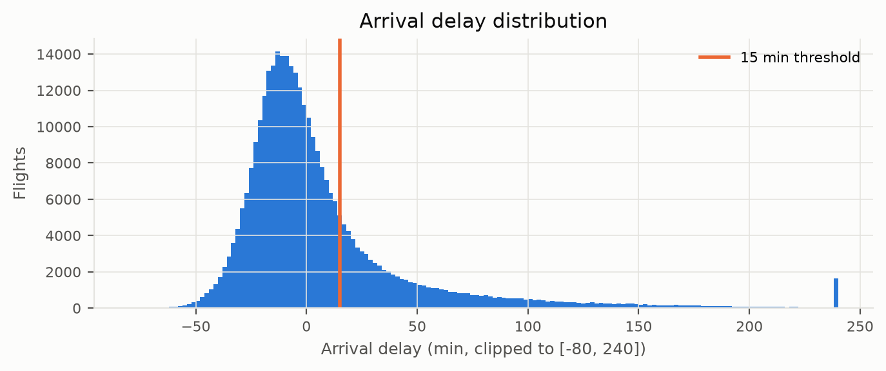
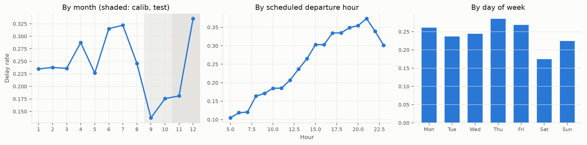
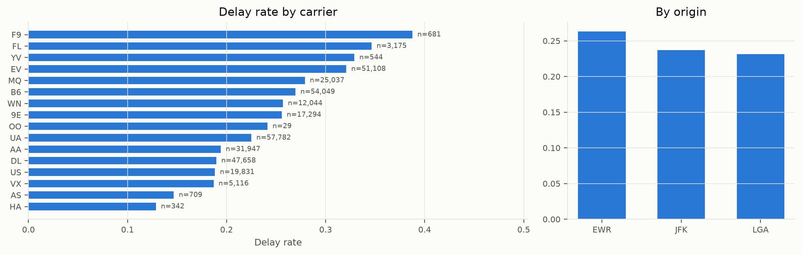
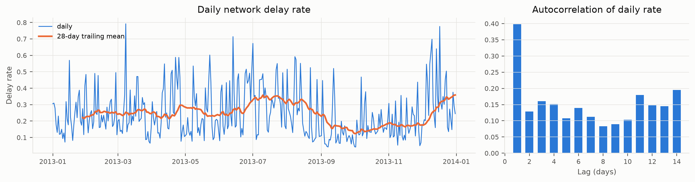
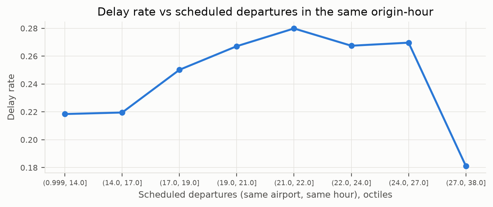
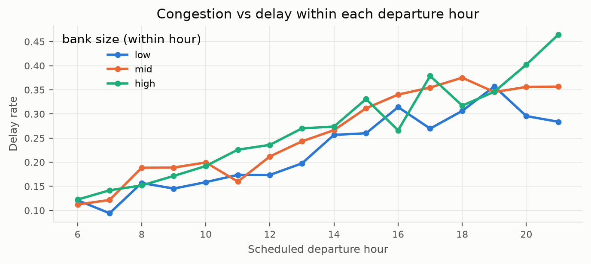
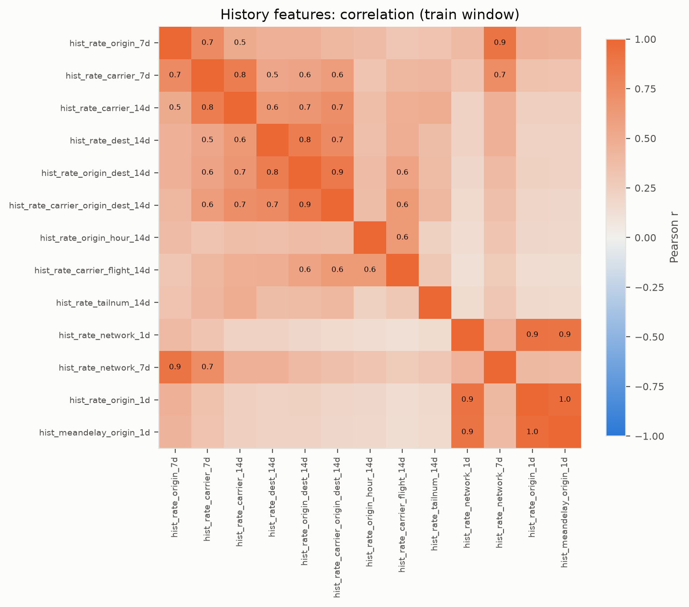

# 01 · Data and EDA

> Summarises [01_eda.ipynb](../notebooks/01_eda.ipynb) (§1–§9). All numbers come from `results/` or the executed notebook outputs.

## Data quality (notebook §2)

Dataset: `nycflights13`, 336,776 departures from EWR, JFK and LGA in 2013.

| check | value |
|---|---|
| rows | 336776 |
| duplicate id | 0 |
| duplicate (date, carrier, flight, origin, sched_dep) | 0 |
| cancelled (no dep_time) | 8255 |
| diverted (departed, no arr_delay) | 1175 |
| missing tailnum | 2512 |
| missing tailnum AND cancelled | 2512 |

Missing values are **structural**: no `dep_time` means cancelled (8,255 flights); departed but no `arr_delay` means diverted (1,175); every missing `tailnum` is a cancellation. Arrival-delay answers are not imputed. The raw EDA retains missing values; later, Logistic Regression median-imputes derived numeric predictors and adds missingness indicators. XGBoost handles numeric missing values natively.

| check | value |
|---|---|
| hour/minute match sched_dep_time (share) | 1 |
| dep_delay = dep_time - sched_dep_time, mod 24h (share) | 1 |
| routes with >1 distinct distance | 2 |
| air_time <= 0 | 0 |

Two routes have more than one distance. Both go to EGE and both change by exactly 1 mile on 2013-03-01 (a reference-data update, no practical effect):

| origin | dest | distance | flights | first | last |
|---|---|---|---|---|---|
| EWR | EGE | 1725 | 51 | 2013-03-01 00:00:00 | 2013-12-31 00:00:00 |
| EWR | EGE | 1726 | 59 | 2013-01-01 00:00:00 | 2013-02-28 00:00:00 |
| JFK | EGE | 1746 | 44 | 2013-03-01 00:00:00 | 2013-12-31 00:00:00 |
| JFK | EGE | 1747 | 59 | 2013-01-01 00:00:00 | 2013-02-28 00:00:00 |

## Target (notebook §4)

`is_delayed = arr_delay ≥ 15 min`. Cancelled and diverted flights have no arrival delay and are dropped from the target (kept in schedule counts; counted as delayed in the sensitivity analysis, see [04](04_evaluation.md)).

| threshold | share |
|---|---|
| >= 15 min | 0.245 |
| >= 30 min | 0.161 |
| >= 60 min | 0.087 |

## When are flights late? (notebook §5)

* **Time of day:** delay rate 10.5% at 5:00 rising to 37.4% at 21:00 (an association consistent with accumulating disruption; this EDA does not isolate its cause).
* **Season:** monthly rates range from 13.7% (month 9) to 33.5% (month 12). Sep–Oct are calm, December is extreme, which makes the chronological split a built-in stress test.
* **Carrier:** rates range from 12.9% to 38.8%; several carriers are tiny (OO has 29 flights).

## Is yesterday informative? (notebook §6)

Lag-1 autocorrelation of the daily delay rate is **0.398**, falling to about 0.13 (mean of lags 8–14): disruption is bursty with short memory, which motivates day-level history features.

## Congestion and the time-of-day confound (notebook §7)

Splitting departure banks into terciles **within each hour** holds the hour fixed: the busiest third is **4.5 percentage points** later than the quietest, and later in 13 of 16 hours. The association remains within departure-hour groups; this does not establish a causal congestion effect.

## Multicollinearity of the history features (notebook §8)

The history rates are strongly inter-correlated (nested windows on the same key; network and origin rates move together). Consequences: L2-regularised LogReg, and **grouped** permutation importance.

## EDA → design decisions (notebook §9)

| EDA observation | design decision |
|---|---|
| Missingness = cancellations / diversions | drop from target, keep in schedule (congestion) counts |
| Strong time-of-day gradient (10% -> 37%) | cyclic dep/arr time + raw hour |
| One year; seasonal months; Sep-Oct calm, Dec extreme | no month feature; chronological split; calibration studied under shift |
| Short-memory daily shocks (lag-1 autocorr ~0.4) | 1-day / 7-day lagged rates (day-level group) |
| Stable carrier / route / aircraft propensities; some tiny groups | 7/14-day entity rates with Bayesian shrinkage (CV-tuned m, window); one-hot min_frequency=50 |
| Congestion correlates with delay but is confounded with hour | scheduled-bank counts, kept and tested by ablation |
| Leakage risk from post-departure columns; 31% of D-1 arrivals land after 20:00 | decision clock 20:00 on D-1; outcomes enter history only once known; three leakage checks |
| History rates strongly inter-correlated (same keys, nested windows) | L2-regularised LogReg; grouped (not per-feature) permutation importance |
