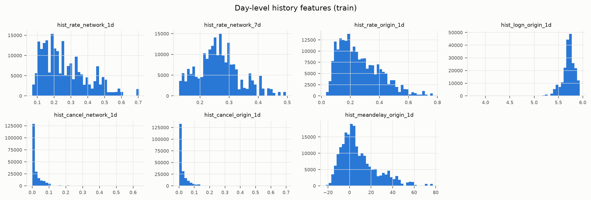
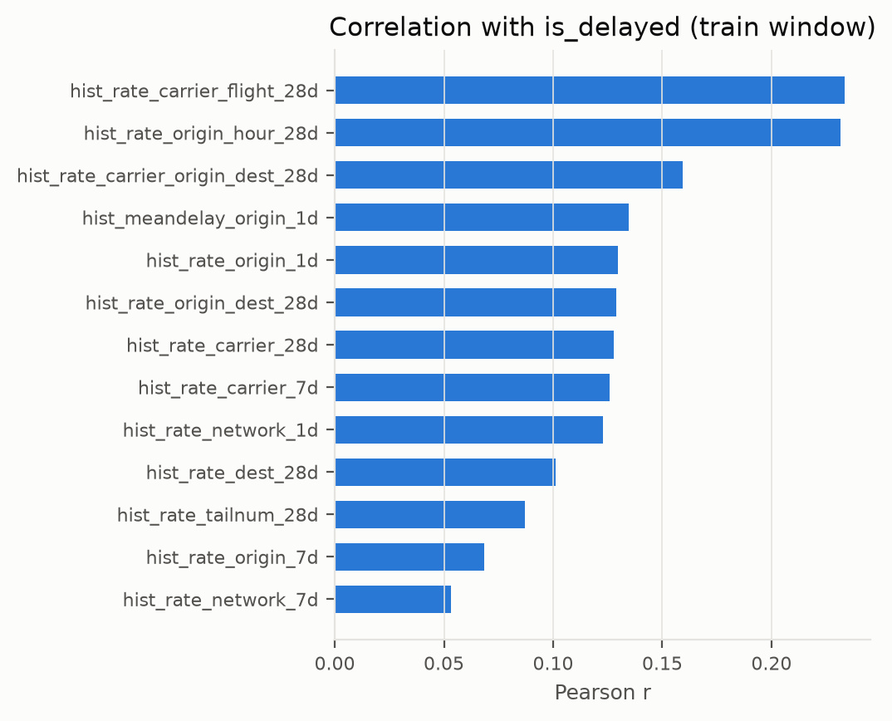

# 02 · Feature engineering

> Summarises [02_feature_engineering.ipynb](../notebooks/02_feature_engineering.ipynb) (§1–§9). All numbers come from `results/` or the executed notebook outputs.

## Decision clock (notebook §1)

Predictions for all flights on day **D** are issued at **20:00 NYC time on D-1**. An outcome may feed a feature for D only if it was **known by then**: an arrival delay at the actual gate arrival (converted to the NYC clock), a cancellation at the scheduled/actual departure. `data.available_date(t) = ceil_day(t − 20h) + 1 day`, and history windows roll over these **availability dates**, not flight dates. Cancelled flights stay in the schedule (congestion) counts.

| usable_after_days | flights | delay_rate | share |
|---|---|---|---|
| 1 | 225400 | 0.183 | 0.689 |
| 2 | 101946 | 0.381 | 0.311 |

**31% of D-1 arrivals land after 20:00** (`usable_after_days = 2`) and are twice as often late (38% vs 18%).

## Time-zone table and DST (notebook §1.1)

`arr_time` is destination-local. Offsets are a **fixed lookup table** (`config.DEST_OFFSET_MIN`) plus the 2013 DST rule (2013-03-10 02:00 → 2013-11-03 02:00; HNL, PHX, SJU, BQN, PSE, STT do not observe DST). It must not be estimated from the flights being featurised, or past features would depend on future data (this was an actual bug caught by the future-dependence test). The table is re-derived from the data in the notebook and checked by a test.

| offset vs NYC (min) | destinations |
|---|---|
| -360 | 1 |
| -240 | 1 |
| -180 | 14 |
| -120 | 8 |
| -60 | 21 |
| 0 | 60 |

## Features (43) and smoothing (notebook §2–§4)

| group | n_features |
|---|---|
| categorical | 3 |
| schedule | 10 |
| congestion | 5 |
| history_entity | 18 |
| history_day | 7 |

Entity history rates use beta-binomial shrinkage toward a past-only network prior: `(late + m·prior)/(flights + m)`, with **m = 5** and a **14-day** long window (7-day short window). Worked example (EWR→CAE) in the notebook.

## Leakage checks (notebook §5; also `tests/test_no_leakage.py`)

**(a) Future outcomes.** Overwrite all post-departure columns from 2013-06-15 onward with random values, rebuild features: cells changed up to the cutoff = **0**, after the cutoff = 4,558,344 (non-vacuous).

**(b) Decision clock.** Randomise the arrival outcomes of D-1 flights that landed after 20:00: D's features must not change; randomising those before 20:00 must change them (positive control).

| target_date | changed_cells_on_D_after_scrambling_late | changed_cells_on_D_after_scrambling_early |
|---|---|---|
| 2013-02-14 | 0 | 12428 |
| 2013-07-11 | 0 | 13078 |
| 2013-12-20 | 0 | 12740 |

**(c) Same-day cancellations.** Check (a) keeps every tail number, so it cannot see a leak through *which rows carry a tail number*; in the raw data all 2,512 missing tail numbers belong to cancelled flights. Cancel 30% of a day's flights the way the data records it (tail number blanked too), rebuild features: every feature of that day's **other** flights must be unchanged (it is, on 2013-02-14, 2013-07-11 and 2013-12-20). Only the cancelled flights' own tail-history features move (positive control); they are excluded wherever cancellations enter the label.

This check found a leak in an earlier version: `tail_leg_idx` (the aircraft's leg number that day) and `tail_legs_day` (its NYC departures that day) were counted by tail number, so cancelling one leg changed the leg number and count of the same aircraft's other day-D flights. Both were removed on leakage grounds (45 → 43 features).

## Clock vs a 2-day lag vs the leaky variant (notebook §6)

Rolling-CV PR-AUC of LogReg at the configured (m, window), C tuned per row:

| decision_hour | best_C | cv_pr_auc_mean | cv_pr_auc_std | meaning |
|---|---|---|---|---|
| 20 | 0.1000 | 0.4714 | 0.0711 | 20:00 on D-1 (used) |
| 0 | 0.0030 | 0.4590 | 0.0743 | 00:00 on D-1 (approximately a two-day lag) |
| 24 | 0.0100 | 0.4812 | 0.0724 | 24:00 on D-1 (later deadline; unavailable at 20:00) |

The 20:00 clock scores 0.4714, compared with 0.4590 at 00:00 (approximately a two-day lag) and 0.4812 at 24:00. The 24:00 scenario permits outcomes unavailable at the chosen 20:00 deadline. These scenarios move fitting and selection cutoffs as well as feature-history cutoffs, so their score differences do not isolate a feature-leakage effect.

## Smoothing m and window, tuned jointly with C (notebook §6)

| smoothing_m | long_window | best_C | cv_pr_auc_mean | cv_pr_auc_std | cv_pr_auc_mean_C0.001 |
|---|---|---|---|---|---|
| 5 | 14 | 0.1000 | 0.4714 | 0.0711 | 0.4692 |
| 5 | 28 | 0.0010 | 0.4674 | 0.0643 | 0.4674 |
| 5 | 56 | 0.0100 | 0.4688 | 0.0689 | 0.4671 |
| 20 | 14 | 0.0100 | 0.4699 | 0.0712 | 0.4678 |
| 20 | 28 | 0.0010 | 0.4666 | 0.0641 | 0.4666 |
| 20 | 56 | 0.0100 | 0.4676 | 0.0689 | 0.4658 |
| 50 | 14 | 0.0100 | 0.4658 | 0.0722 | 0.4642 |
| 50 | 28 | 0.0010 | 0.4641 | 0.0640 | 0.4641 |
| 50 | 56 | 0.0030 | 0.4652 | 0.0681 | 0.4636 |

The CV-best pair is **m = 5, window = 14, C = 0.1**; re-tuning jointly with C (it was first scored at a fixed C = 0.001) selected the same pair, so nothing changed. The pipeline fails if `config` disagrees with this table.

## Month features removed (notebook §7)

| features | model | fold_m5 | fold_m6 | fold_m7 | fold_m8 | cv_pr_auc_mean |
|---|---|---|---|---|---|---|
| without month | logreg | 0.4343 | 0.5052 | 0.5525 | 0.3936 | 0.4714 |
| without month | xgboost | 0.4315 | 0.4253 | 0.5479 | 0.3953 | 0.4500 |
| with month | logreg | 0.4250 | 0.5066 | 0.5491 | 0.3955 | 0.4691 |
| with month | xgboost | 0.4295 | 0.4564 | 0.5476 | 0.3858 | 0.4548 |

Adding cyclic month features lowers LogReg mean CV AP from 0.4714 to 0.4691 (two folds improve, two worsen). For fixed-tree XGBoost the mean rises from 0.4500 to 0.4548, but three of four folds worsen; the gain comes from June alone (+0.031). Training contains only months 1–8 in one year, so Sep–Dec month values never occur in training; these checks do not establish a reusable seasonal effect. **Decision: no month feature**, supported by the final model's development CV. The earlier test-based justification remains withdrawn.

## Day-level history as its own group (notebook §8)

`hist_rate_network_1d` takes one value per day (shared by hundreds of flights), so a flexible model could use it as a date identifier. It is kept separate so the ablation can test it. **CV evidence** ([04](04_evaluation.md), Part A.4): LogReg mean gain +0.0114, improving 3/4 folds, supports retaining the group. XGBoost has a slightly negative mean gain (−0.0015), despite improving in 3/4 folds; this does not establish a general absence of value for that family.

