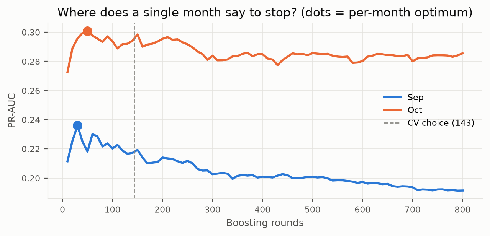
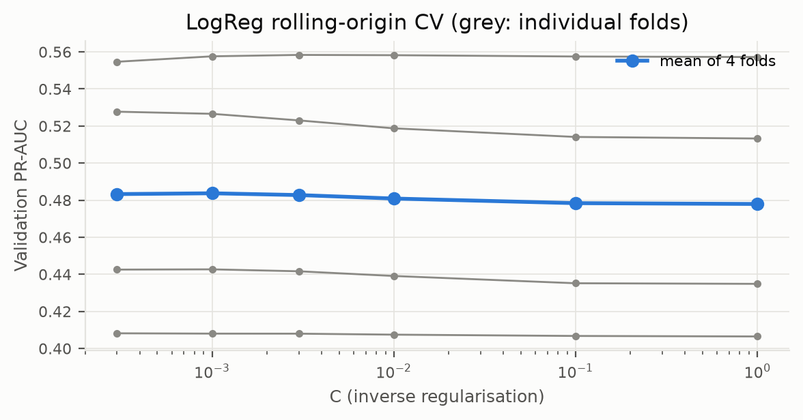

# 03 · Model training

> Summarises [03_model_training.ipynb](../notebooks/03_model_training.ipynb) (§1–§9). All numbers come from `results/` or the executed notebook outputs.

## Split (notebook §1)

| split | rows | delay_rate | from | to |
|---|---|---|---|---|
| train | 211684 | 0.265 | 2013-01-08 | 2013-08-31 |
| calib | 55628 | 0.157 | 2013-09-01 | 2013-10-31 |
| test | 53991 | 0.258 | 2013-11-01 | 2013-12-31 |

Jan 1–7 is excluded (warm-up). The table lists scoring rows, not all eligible fitting labels: the final fit uses 211,517 training labels, excluding 167 unavailable at its deadline. CV also enforces its fitting/selection clocks. Base rate shifts: 26.5% train, 15.7% calibration, 25.8% test (Nov 18.1%, Dec 33.5%).

## Baselines (notebook §3)

*Prior* (training base rate) and *Route history* (smoothed 14-day carrier-route rate) sit beside every learned model in every comparison table.

## Rolling-origin CV (notebook §4)

Folds: train Jan–Apr → validate May; Jan–May → Jun; Jan–Jun → Jul; Jan–Jul → Aug. A single validation month (Sep) was abandoned because it is the calmest month and its best tree count differed from October's on nearly flat curves.

## LogReg: C grid, CV mean ± sd (notebook §5)

| C | cv_mean | cv_std |
|---|---|---|
| 0.0003 | 0.4664 | 0.0686 |
| 0.0010 | 0.4690 | 0.0697 |
| 0.0030 | 0.4706 | 0.0701 |
| 0.0100 | 0.4713 | 0.0705 |
| 0.1000 | 0.4715 | 0.0710 |
| 1.0000 | 0.4712 | 0.0710 |

Chosen **C = 0.1** (the curve is flat above C ≈ 0.003; the fold spread is far larger than any difference between C values).

## XGBoost: grid and top configurations (notebook §6)

Grid (48 combinations, 16 sampled): depth {2, 3, 5}, min_child_weight {20, 100}, colsample {0.5, 0.8}, λ {1, 10}, learning rate {0.03, 0.1}, subsample 0.8; up to 3,000 trees with early stopping (100) on each validation fold; tree count = mean of the four best iterations.

| config | mean_pr_auc | std_pr_auc | n_trees |
|---|---|---|---|
| 15 | 0.4761 | 0.0703 | 148 |
| 0 | 0.4728 | 0.0688 | 98 |
| 5 | 0.4709 | 0.0665 | 204 |
| 1 | 0.4693 | 0.0692 | 373 |
| 11 | 0.4680 | 0.0674 | 337 |
| 14 | 0.4675 | 0.0671 | 104 |
| 10 | 0.4671 | 0.0665 | 224 |
| 4 | 0.4623 | 0.0625 | 63 |

Chosen: depth 2, learning rate 0.1, min_child_weight 20, colsample 0.5, λ 1.0, subsample 0.8, **148 trees**. Its in-fold early-stopping search score is 0.4761 ± 0.0703; its fixed-tree comparison score is 0.4474 ± 0.0686. The search configurations and tree count are selected on the same development folds, so these are not independent nested-CV estimates.

## Final-model rule (notebook §7)

**Rule (fixed before test):** the model with the higher mean rolling-CV PR-AUC, **each scored as deployed**. XGBoost's search score early-stops on the validation fold itself (optimistic), so it is re-scored with its fixed, fold-averaged tree count.

| model | calibration | cv_pr_auc_mean | cv_pr_auc_std | fold_m5 | fold_m6 | fold_m7 | fold_m8 |
|---|---|---|---|---|---|---|---|
| Prior (base rate) | none | 0.2777 | 0.0481 | 0.2267 | 0.3152 | 0.3221 | 0.2467 |
| Route history | none | 0.3477 | 0.0601 | 0.2766 | 0.3911 | 0.4034 | 0.3197 |
| LogReg (as deployed) | raw | 0.4715 | 0.0710 | 0.4350 | 0.5055 | 0.5523 | 0.3933 |
| XGBoost (as deployed, fixed trees) | raw | 0.4474 | 0.0686 | 0.4338 | 0.4193 | 0.5466 | 0.3899 |
| XGBoost (in-fold early stopping, optimistic; not used) | raw | 0.4761 | 0.0703 | 0.4400 | 0.5054 | 0.5590 | 0.3999 |

Paired per-fold difference LogReg − XGBoost: +0.0012, +0.0862, +0.0057, +0.0034 (mean +0.0241, sd 0.0414; LogReg leads in 4/4 folds). Four folds do not establish population-level superiority.

LogReg has the higher development CV mean (0.4715 versus 0.4474), so it is selected by the declared rule. The test AP-difference interval (XGBoost − LogReg, [-0.013, +0.037]) includes zero: it does not establish a test-performance difference, equivalence, or noninferiority. Test exposure during development remains disclosed. XGBoost's optimistic in-fold search score (0.4761) would reverse the family choice if used in place of its fixed-tree score. See the [development protocol](development_protocol.md).

## Theory notes

* **Logistic regression** minimises the L2-regularised log-loss `−(1/n)Σ[y log p + (1−y) log(1−p)] + ‖w‖²/(2Cn)`; convex; smaller C shrinks harder. This helps with correlated history features. Convexity alone does not establish uniqueness without additional conditions.
* **XGBoost** fits trees stage-wise on a second-order Taylor expansion of the loss (gradients g = p − y, Hessians h = p(1−p)) plus a complexity penalty; optimal leaf weight −G/(H+λ).
* **Log-loss is a strictly proper scoring rule**: minimised only by the true probability, so training pushes toward calibration on the training distribution (the Brier score is also proper; accuracy and AUC are not).
