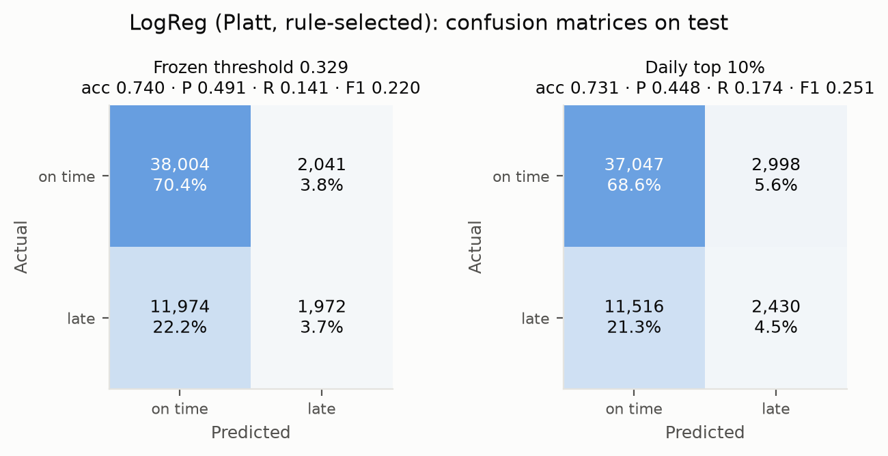

# 04 · Evaluation

> Summarises [04_evaluation.ipynb](../notebooks/04_evaluation.ipynb) (Parts A and B). All numbers come from `results/` or the executed notebook outputs.

Evidence is kept apart: **Part A** is what any decision rests on (CV / Sep–Oct); **Part B** is exploratory (test). See the [development protocol](development_protocol.md).

## Metric theory (notebook §1)

* **PR-AUC = average precision** (step-wise Σ (R_k − R_{k−1}) P_k, not the trapezoid); baseline = base rate. ROC-AUC ignores the base rate; PR matches what an ops desk sees under imbalance.
* **ECE** = Σ_b |B_b|/n · |ȳ_b − p̄_b|: a *biased* estimator (noise adds, grows with bins) and binning-dependent, so both **equal-width** (15 bins) and **approximately equal-mass** ECE are reported next to the Brier score. Equal-mass ECE starts with 15 balanced rank bins, moves each boundary to the end of its tied-probability group, and collapses duplicate boundaries. Identical probabilities stay together regardless of row order; ties can produce fewer bins or unequal counts. Constant predictions use one bin. It is a marginal check: the *prior* has a small ECE when the test base rate is near the training one (0.007 here), which says nothing about skill.
* **Platt / temperature scaling vs isotonic:** Platt = σ(a·logit p + b), 2 parameters, smooth; temperature scaling is its 1-parameter case; isotonic is a monotone step function (flexible, data-hungry). All assume calibration data resemble deployment data.
* **`oracle_recall@p`:** best recall at precision ≥ p with the threshold tuned **on the evaluated labels**. A point on the PR curve for **comparing models only**, never an operating result.
* **Day-block bootstrap:** whole days are resampled (flights within a day are correlated); model differences are paired on the same days.

# Part A · Evidence used for selection (CV / Sep–Oct)

### A.1 Final model: rolling-CV PR-AUC as deployed (with references)

| model | calibration | cv_pr_auc_mean | cv_pr_auc_std |
|---|---|---|---|
| Prior (base rate) | none | 0.2777 | 0.0481 |
| Route history | none | 0.3477 | 0.0601 |
| LogReg (as deployed) | raw | 0.4714 | 0.0711 |
| XGBoost (as deployed, fixed trees) | raw | 0.4500 | 0.0671 |
| XGBoost (in-fold early stopping, optimistic; not used) | raw | 0.4749 | 0.0693 |

LogReg has the higher development CV mean (0.4714 versus 0.4500), so it is selected by the declared rule. The test AP-difference interval (XGBoost − LogReg, [-0.010, +0.040]) includes zero: it does not establish a test-performance difference, equivalence, or noninferiority. Test exposure during development remains disclosed. The development CV reference scores are route history 0.3477 and prior 0.2777.

### A.2 History settings, decision clock, month (CV)

The selected settings remain **m = 5, window = 14, C = 0.1**. The 20:00 clock scores 0.4714, compared with 0.4590 at 00:00 (approximately a two-day lag) and 0.4812 at 24:00. The 24:00 scenario permits outcomes unavailable at the chosen 20:00 deadline. These scenarios move fitting and selection cutoffs as well as feature-history cutoffs, so their score differences do not isolate a feature-leakage effect.

Adding cyclic month features lowers LogReg mean CV AP from 0.4714 to 0.4691 (two folds improve, two worsen). For fixed-tree XGBoost the mean rises from 0.4500 to 0.4548, but three of four folds worsen; the gain comes from June alone (+0.031). Training contains only months 1–8 in one year, so Sep–Dec month values never occur in training; these checks do not establish a reusable seasonal effect. **Decision: no month feature**, supported by the final model's development CV. The earlier test-based justification remains withdrawn. Details: [02](02_feature_engineering.md).

### A.3 Calibration rule, decided on Sep–Oct

Rule (fixed before test): fit Platt and isotonic on **September**, check ECE on **October**, keep **raw** unless the best recalibrator wins by more than **0.005**; then refit on eligible Sep–Oct outcomes known before the first November prediction (55,377 labels; 251 excluded). September fitting and October checking also enforce their own availability deadlines.

| model | calibrator | check_ece | check_ece_equal_mass | check_brier | gain_vs_raw |
|---|---|---|---|---|---|
| logreg | raw | 0.0626 | 0.0633 | 0.1399 | 0.0000 |
| logreg | platt | 0.0329 | 0.0329 | 0.1368 | 0.0297 |
| logreg | isotonic | 0.0339 | 0.0336 | 0.1376 | 0.0287 |
| xgboost | raw | 0.0235 | 0.0238 | 0.1379 | 0.0000 |
| xgboost | platt | 0.0432 | 0.0432 | 0.1401 | -0.0197 |
| xgboost | isotonic | 0.0427 | 0.0427 | 0.1404 | -0.0193 |

Outcome: **LogReg → Platt (rule-selected)** (October ECE gain 0.0297); **XGBoost → raw (rule-selected)**. Causal **rolling Platt** (refit daily on the trailing N = 28 days of known outcomes; N fixed a priori, 14/56 reported as sensitivity only) is the adaptive alternative, evaluated in Part B.

### A.4 Ablation: CV evidence

| model | calibration | step | cv_gain_mean | cv_folds_improved |
|---|---|---|---|---|
| LogReg | raw | + congestion | 0.0205 | 4/4 |
| LogReg | raw | + history_entity | 0.0201 | 4/4 |
| LogReg | raw | + history_day | 0.0114 | 3/4 |
| XGBoost | raw | + congestion | 0.0085 | 3/4 |
| XGBoost | raw | + history_entity | 0.0068 | 2/4 |
| XGBoost | raw | + history_day | -0.0015 | 3/4 |

At the selected hyperparameters, LogReg mean CV AP increases with congestion (+0.0205, 4/4 folds), entity history (+0.0201, 4/4), and day-level history (+0.0114, 3/4). For XGBoost, the corresponding mean gains are +0.0085 (3/4), +0.0068 (2/4), and −0.0015 (3/4). The last result has a slightly negative mean despite improvement in three folds. These are development comparisons at the chosen settings, not independent estimates after nested selection.

| model | calibration | features | n_features | cv_pr_auc_mean | cv_pr_auc_std |
|---|---|---|---|---|---|
| Prior (base rate) | none | (baseline) | 0 | 0.2777 | 0.0481 |
| Route history | none (smoothed rate) | (baseline) | 0 | 0.3477 | 0.0601 |
| LogReg | raw | schedule + ids | 13 | 0.4193 | 0.0634 |
| LogReg | raw | + congestion | 18 | 0.4399 | 0.0717 |
| LogReg | raw | + history_entity | 36 | 0.4600 | 0.0730 |
| LogReg | raw | + history_day | 43 | 0.4714 | 0.0711 |
| LogReg | raw | history only | 25 | 0.4480 | 0.0760 |
| XGBoost | raw | schedule + ids | 13 | 0.4363 | 0.0749 |
| XGBoost | raw | + congestion | 18 | 0.4448 | 0.0844 |
| XGBoost | raw | + history_entity | 36 | 0.4515 | 0.0829 |
| XGBoost | raw | + history_day | 43 | 0.4500 | 0.0671 |
| XGBoost | raw | history only | 25 | 0.4242 | 0.0880 |

### A.5 Grouped permutation importance (Sep–Oct)

| group | LogReg | XGBoost |
|---|---|---|
| categorical | 0.0381 | 0.0133 |
| congestion | 0.0458 | 0.0117 |
| history_day | 0.0263 | 0.0032 |
| history_entity | 0.0290 | 0.0190 |
| schedule | 0.0482 | 0.0501 |

Grouped permutation gives LogReg AP drops of schedule 0.048, congestion 0.046, categorical 0.038, entity history 0.029, and day-level history 0.026. For XGBoost: schedule 0.050, entity history 0.019, categorical 0.013, congestion 0.012, and day-level history 0.003. These describe sensitivity to shuffled feature groups; they do not identify causal effects. For XGBoost, the ordering by drop is schedule, entity history, categorical, congestion, then day-level history.

# Part B · Exploratory test-set findings (ablation test diffs, calibration study, target sensitivity)

Test = Nov–Dec 2013. The current rules use the development evidence described in Part A. Test numbers were visible during development, so these findings are exploratory and do not become an untouched confirmation merely by re-justifying the rules.

## B.1 Pre-specified rules on test

### Headline test metrics: references, calibration variants, final model

| model | calibration | pr_auc | roc_auc | brier | ece | ece_equal_mass | oracle_recall@p0.40 |
|---|---|---|---|---|---|---|---|
| Prior (base rate) | none | 0.258 | 0.500 | 0.192 | 0.007 | 0.007 | 0.000 |
| Route history | none (smoothed rate) | 0.353 | 0.621 | 0.187 | 0.037 | 0.038 | 0.244 |
| LogReg (raw) | raw | 0.393 | 0.653 | 0.181 | 0.019 | 0.022 | 0.421 |
| LogReg (Platt, rule-selected) | Platt (rule-selected) | 0.393 | 0.653 | 0.187 | 0.082 | 0.082 | 0.421 |
| LogReg (rolling Platt 28d) | rolling Platt 28d (causal) | 0.392 | 0.657 | 0.181 | 0.027 | 0.027 | 0.428 |
| XGBoost (raw, rule-selected) | raw (rule-selected) | 0.407 | 0.665 | 0.179 | 0.027 | 0.027 | 0.483 |
| XGBoost (rolling Platt 28d) | rolling Platt 28d (causal) | 0.396 | 0.664 | 0.180 | 0.023 | 0.022 | 0.438 |

`LogReg (Platt, rule-selected)` is the model as the pre-declared rule deploys it. Its ranking equals `LogReg (raw)` (Platt is monotone), but its calibration does not: **test ECE 0.082 (Platt, rule-selected) vs 0.019 (raw) vs 0.027 (rolling Platt 28d)**. **The static rule fails in December** (below). Both learned models beat both references on PR-AUC (0.393 LogReg, 0.407 XGBoost, 0.353 route history, 0.258 prior); the prior's low fixed-width and equal-mass ECE (both 0.007) reflects close overall means, not ranking skill. `oracle_recall@p0.40` is a comparison metric only.

### November and December

| model | calibration | split | base_rate | pr_auc | roc_auc | brier | ece |
|---|---|---|---|---|---|---|---|
| Prior (base rate) | none | test_m11 | 0.181 | 0.181 | 0.500 | 0.155 | 0.084 |
| Route history | none (smoothed rate) | test_m11 | 0.181 | 0.221 | 0.560 | 0.149 | 0.035 |
| LogReg (raw) | raw | test_m11 | 0.181 | 0.291 | 0.655 | 0.146 | 0.056 |
| LogReg (Platt, rule-selected) | Platt (rule-selected) | test_m11 | 0.181 | 0.291 | 0.655 | 0.142 | 0.022 |
| LogReg (rolling Platt 28d) | rolling Platt 28d (causal) | test_m11 | 0.181 | 0.285 | 0.649 | 0.142 | 0.005 |
| XGBoost (raw, rule-selected) | raw (rule-selected) | test_m11 | 0.181 | 0.273 | 0.638 | 0.143 | 0.018 |
| XGBoost (rolling Platt 28d) | rolling Platt 28d (causal) | test_m11 | 0.181 | 0.263 | 0.631 | 0.144 | 0.013 |
| Prior (base rate) | none | test_m12 | 0.335 | 0.335 | 0.500 | 0.228 | 0.070 |
| Route history | none (smoothed rate) | test_m12 | 0.335 | 0.394 | 0.574 | 0.225 | 0.060 |
| LogReg (raw) | raw | test_m12 | 0.335 | 0.456 | 0.631 | 0.217 | 0.060 |
| LogReg (Platt, rule-selected) | Platt (rule-selected) | test_m12 | 0.335 | 0.456 | 0.631 | 0.233 | 0.143 |
| LogReg (rolling Platt 28d) | rolling Platt 28d (causal) | test_m12 | 0.335 | 0.431 | 0.603 | 0.220 | 0.050 |
| XGBoost (raw, rule-selected) | raw (rule-selected) | test_m12 | 0.335 | 0.467 | 0.640 | 0.215 | 0.066 |
| XGBoost (rolling Platt 28d) | rolling Platt 28d (causal) | test_m12 | 0.335 | 0.440 | 0.619 | 0.216 | 0.037 |

### LogReg vs XGBoost: day-block bootstrap (rule-selected variants)

| metric | XGBoost 95% CI | LogReg 95% CI | XGB − LR 95% CI |
|---|---|---|---|
| pr_auc | [0.346, 0.468] | [0.340, 0.450] | [-0.010, +0.040] |
| roc_auc | [0.637, 0.694] | [0.620, 0.682] | [-0.008, +0.032] |

XGBoost's test AP is higher by 0.0140, but the paired 95% interval [−0.010, +0.040] includes zero. This does not establish a difference, equivalence, or noninferiority; it does not replace the development CV selection rule.

### Operating policies (fixed before test)

* **Primary:** each day flag the top **10%** riskiest flights (a-priori capacity assumption; rank-based, so a monotone within-day recalibration cannot change it; ties broken by a seeded random draw).
* **Secondary:** a score threshold frozen on Sep–Oct to reach precision ≥ 0.4 (0.50 was unreachable on Sep–Oct, so it was lowered to 0.40).

| model | calibration | role | policy | flag_rate | precision | recall | lift | threshold |
|---|---|---|---|---|---|---|---|---|
| Prior (base rate) | none | primary | daily top 10% | 0.101 | 0.243 | 0.095 | 0.941 | – |
| Prior (base rate) | none | secondary | frozen thr for P>=0.4 (from Sep-Oct) | 0.000 | – | 0.000 | – | ∞ |
| Route history | none (smoothed rate) | primary | daily top 10% | 0.101 | 0.358 | 0.139 | 1.387 | – |
| Route history | none (smoothed rate) | secondary | frozen thr for P>=0.4 (from Sep-Oct) | 0.059 | 0.425 | 0.097 | 1.646 | 0.468907 |
| LogReg (Platt, rule-selected) | Platt (rule-selected) | primary | daily top 10% | 0.101 | 0.448 | 0.174 | 1.733 | – |
| LogReg (Platt, rule-selected) | Platt (rule-selected) | secondary | frozen thr for P>=0.4 (from Sep-Oct) | 0.074 | 0.491 | 0.141 | 1.902 | 0.329078 |
| XGBoost (raw, rule-selected) | raw (rule-selected) | primary | daily top 10% | 0.101 | 0.438 | 0.171 | 1.697 | – |
| XGBoost (raw, rule-selected) | raw (rule-selected) | secondary | frozen thr for P>=0.4 (from Sep-Oct) | 0.033 | 0.549 | 0.070 | 2.125 | 0.483837 |

**Primary result (LogReg, static Platt rule-selected, test): precision 0.448, recall 0.174, lift 1.73×.** The prior lift is 0.94, route history 1.39, and XGBoost 1.70. The LogReg threshold frozen on eligible Sep–Oct outcomes is 0.329078; it flags 3.8% of calibration flights and 7.4% of test flights. Test precision is 0.491 and recall 0.141. Ranking-based selection keeps the chosen daily share; its precision and recall can still change across periods.

### Accuracy, precision, recall, F1 and confusion matrix (test)

Computed at the same two pre-declared operating points; no threshold is tuned on test labels. Source: `results/operating_policies.csv` (columns `accuracy`, `precision`, `recall`, `f1`, `tp`, `fp`, `fn`, `tn`).

| model | policy | accuracy | precision | recall | F1 | TP | FP | FN | TN |
|---|---|---|---|---|---|---|---|---|---|
| Prior (base rate) | frozen threshold | 0.742 | – | 0.000 | 0.000 | 0 | 0 | 13946 | 40045 |
| Prior (base rate) | daily top 10% | 0.690 | 0.243 | 0.095 | 0.136 | 1319 | 4109 | 12627 | 35936 |
| Route history | frozen threshold | 0.733 | 0.425 | 0.097 | 0.158 | 1350 | 1826 | 12596 | 38219 |
| Route history | daily top 10% | 0.713 | 0.358 | 0.139 | 0.201 | 1944 | 3484 | 12002 | 36561 |
| LogReg (Platt, rule-selected) | frozen threshold | 0.740 | 0.491 | 0.141 | 0.220 | 1972 | 2041 | 11974 | 38004 |
| LogReg (Platt, rule-selected) | daily top 10% | 0.731 | 0.448 | 0.174 | 0.251 | 2430 | 2998 | 11516 | 37047 |
| XGBoost (raw, rule-selected) | frozen threshold | 0.745 | 0.549 | 0.070 | 0.124 | 971 | 798 | 12975 | 39247 |
| XGBoost (raw, rule-selected) | daily top 10% | 0.729 | 0.438 | 0.171 | 0.246 | 2379 | 3049 | 11567 | 36996 |

* **Accuracy is misleading at this class balance:** predicting every flight on time (the prior's frozen-threshold row, which flags nothing) is already 74.2% accurate. LogReg is no more accurate (0.740 / 0.731) yet catches 1,972 / 2,430 late flights that rule misses; precision, recall and PR-AUC show this, accuracy does not.
* The daily top 10% gives LogReg the highest F1 (0.251). Most errors are missed delays: 11,974 false negatives against 2,041 false alarms at the frozen threshold.

## B.2 Exploratory findings

### Calibration study: every variant, Nov and Dec separately

| model | calibration | ece_test | ece_test_m11 | ece_test_m12 | ece_equal_mass_test | brier_test | brier_test_m11 | brier_test_m12 |
|---|---|---|---|---|---|---|---|---|
| Prior (base rate) | none | 0.0067 | 0.0840 | 0.0704 | 0.0067 | 0.1916 | 0.1553 | 0.2279 |
| Route history | none (smoothed rate) | 0.0373 | 0.0352 | 0.0602 | 0.0380 | 0.1869 | 0.1492 | 0.2246 |
| LogReg (raw) | raw | 0.0187 | 0.0560 | 0.0600 | 0.0224 | 0.1812 | 0.1456 | 0.2168 |
| LogReg (Platt, static) | Platt (static, fit Sep-Oct) | 0.0824 | 0.0218 | 0.1434 | 0.0824 | 0.1874 | 0.1418 | 0.2330 |
| LogReg (isotonic, static) | isotonic (static, fit Sep-Oct) | 0.0823 | 0.0234 | 0.1423 | 0.0810 | 0.1875 | 0.1420 | 0.2329 |
| LogReg (rolling Platt 14d) | rolling Platt 14d (causal) | 0.0214 | 0.0111 | 0.0403 | 0.0221 | 0.1807 | 0.1432 | 0.2182 |
| LogReg (rolling Platt 28d) | rolling Platt 28d (causal) | 0.0271 | 0.0051 | 0.0503 | 0.0267 | 0.1810 | 0.1419 | 0.2199 |
| LogReg (rolling Platt 56d) | rolling Platt 56d (causal) | 0.0512 | 0.0134 | 0.0890 | 0.0512 | 0.1821 | 0.1417 | 0.2224 |
| XGBoost (raw) | raw | 0.0269 | 0.0178 | 0.0661 | 0.0269 | 0.1793 | 0.1433 | 0.2152 |
| XGBoost (Platt, static) | Platt (static, fit Sep-Oct) | 0.0803 | 0.0319 | 0.1298 | 0.0803 | 0.1860 | 0.1439 | 0.2280 |
| XGBoost (isotonic, static) | isotonic (static, fit Sep-Oct) | 0.0800 | 0.0317 | 0.1294 | 0.0800 | 0.1861 | 0.1441 | 0.2281 |
| XGBoost (rolling Platt 14d) | rolling Platt 14d (causal) | 0.0218 | 0.0128 | 0.0392 | 0.0216 | 0.1795 | 0.1439 | 0.2151 |
| XGBoost (rolling Platt 28d) | rolling Platt 28d (causal) | 0.0233 | 0.0129 | 0.0368 | 0.0218 | 0.1798 | 0.1437 | 0.2159 |
| XGBoost (rolling Platt 56d) | rolling Platt 56d (causal) | 0.0387 | 0.0210 | 0.0571 | 0.0387 | 0.1799 | 0.1433 | 0.2166 |

Static Platt has LogReg ECE 0.022 in November and 0.143 in December (December base rate 33.5%): **the static rule fails in December**. Raw LogReg has test ECE 0.019 overall, but its monthly errors are larger; a close overall mean prediction and base rate do not establish reliable probabilities in every month. Rolling Platt with the pre-specified 28-day window has test ECE 0.027 for LogReg (November 0.005, December 0.050) and 0.023 for XGBoost. LogReg sensitivity windows of 14 and 56 days give test ECE 0.021 and 0.051. These test diagnostics do not select a new final variant or prove a cause of the errors.

### Ablation: exploratory test differences

| model | calibration | step | test_diff | test_diff_ci_lo | test_diff_ci_hi |
|---|---|---|---|---|---|
| LogReg | raw | + congestion | 0.0068 | -0.0098 | 0.0268 |
| LogReg | raw | + history_entity | 0.0328 | 0.0158 | 0.0496 |
| LogReg | raw | + history_day | 0.0090 | -0.0094 | 0.0264 |
| XGBoost | raw | + congestion | -0.0010 | -0.0138 | 0.0121 |
| XGBoost | raw | + history_entity | 0.0484 | 0.0262 | 0.0698 |
| XGBoost | raw | + history_day | 0.0135 | -0.0201 | 0.0473 |

LogReg test AP differences are: congestion +0.0068 [−0.0098, +0.0268], entity history +0.0328 [+0.0158, +0.0496], and day-level history +0.0090 [−0.0094, +0.0264]. XGBoost differences are −0.0010 [−0.0138, +0.0121], +0.0484 [+0.0262, +0.0698], and +0.0135 [−0.0201, +0.0473], respectively. Only the entity-history intervals exclude zero in these exploratory comparisons. These results do not establish causal contributions.

### Target sensitivity (cancelled and diverted = delayed)

A tail number is missing only for cancelled flights (all 2,512 cases), so once cancellations count as delayed, the tail-number history features reveal the label (a blanked tail has no history). An earlier version kept all tail features and reported LogReg AP 0.446 and XGBoost 0.455. Both targets are now refitted on the same 41 features without `hist_rate_tailnum_14d` and `hist_logn_tailnum_14d` (the aircraft-rotation features were removed from the model altogether, see [02](02_feature_engineering.md)); on the main target LogReg test AP is 0.393 with or without them, so main-target rows here differ only slightly from the headline table.

| target | model | calibration | n_test | base_rate | pr_auc | roc_auc | brier | ece | top10_precision | top10_recall | top10_lift | xgb_minus_lr_pr_auc_ci |
|---|---|---|---|---|---|---|---|---|---|---|---|---|
| arr_delay>=15 (main) | Prior (base rate) | none | 53991 | 0.258 | 0.258 | 0.500 | 0.192 | 0.007 | 0.243 | 0.095 | 0.941 | – |
| arr_delay>=15 (main) | Route history | none (smoothed rate) | 53991 | 0.258 | 0.353 | 0.621 | 0.187 | 0.037 | 0.358 | 0.139 | 1.387 | – |
| arr_delay>=15 (main) | LogReg (raw) | raw | 53991 | 0.258 | 0.393 | 0.653 | 0.181 | 0.019 | 0.447 | 0.174 | 1.732 | [-0.010, +0.037] |
| arr_delay>=15 (main) | XGBoost (raw) | raw | 53991 | 0.258 | 0.405 | 0.662 | 0.180 | 0.026 | 0.437 | 0.170 | 1.691 | [-0.010, +0.037] |
| arr_delay>=15 OR cancelled/diverted | Prior (base rate) | none | 55403 | 0.277 | 0.277 | 0.500 | 0.200 | 0.011 | 0.262 | 0.095 | 0.946 | – |
| arr_delay>=15 OR cancelled/diverted | Route history | none (smoothed rate) | 55403 | 0.277 | 0.374 | 0.621 | 0.196 | 0.047 | 0.377 | 0.137 | 1.359 | – |
| arr_delay>=15 OR cancelled/diverted | LogReg (raw) | raw | 55403 | 0.277 | 0.410 | 0.649 | 0.190 | 0.027 | 0.461 | 0.167 | 1.662 | [-0.014, +0.045] |
| arr_delay>=15 OR cancelled/diverted | XGBoost (raw) | raw | 55403 | 0.277 | 0.422 | 0.659 | 0.188 | 0.025 | 0.454 | 0.165 | 1.637 | [-0.014, +0.045] |

Counting cancellation/diversion proxies as delayed raises the test base rate from 25.8% to 27.7%. In that sensitivity run, raw LogReg AP is 0.410 and raw XGBoost AP is 0.422; both exceed the reference scores. Their test AP-difference interval is [−0.014, +0.045], which does not establish a difference or equivalence. Top-10% lifts are 1.66 for LogReg, 1.64 for XGBoost, and 0.95 for the prior. This is one alternative target check, not proof that findings are independent of all missing-outcome definitions.

### Covariate shift: PSI and adversarial validation

| feature | group | psi_calib | psi_test |
|---|---|---|---|
| days_to_holiday | schedule | 0.261 | 4.769 |
| hist_logn_origin_7d | history_entity | 2.269 | 1.265 |
| hist_rate_network_7d | history_day | 5.147 | 1.058 |
| hist_rate_origin_7d | history_entity | 3.433 | 0.755 |
| sched_origin_day | congestion | 2.056 | 0.610 |
| hist_rate_carrier_14d | history_entity | 2.631 | 0.383 |
| hist_rate_dest_14d | history_entity | 2.143 | 0.292 |
| hist_logn_carrier_14d | history_entity | 0.472 | 0.289 |
| hist_cancel_network_1d | history_day | 1.229 | 0.222 |
| hist_rate_carrier_7d | history_entity | 1.699 | 0.209 |

| comparison | features | n_features | adversarial_auc |
|---|---|---|---|
| train vs calib | all features | 43 | 1.000 |
| train vs calib | categorical | 3 | 0.562 |
| train vs calib | schedule | 10 | 0.785 |
| train vs calib | congestion | 5 | 0.984 |
| train vs calib | history_entity | 18 | 1.000 |
| train vs calib | history_day | 7 | 1.000 |
| train vs test | all features | 43 | 1.000 |
| train vs test | categorical | 3 | 0.562 |
| train vs test | schedule | 10 | 0.921 |
| train vs test | congestion | 5 | 0.964 |
| train vs test | history_entity | 18 | 0.998 |
| train vs test | history_day | 7 | 1.000 |

PSI: the largest shifts into Sep–Oct are hist_rate_network_7d, hist_rate_origin_7d, hist_rate_carrier_14d (history rates follow the season by design), and into Nov–Dec days_to_holiday, hist_logn_origin_7d, hist_rate_network_7d; `days_to_holiday` is the largest (PSI 4.8) because Thanksgiving, Christmas and New Year all fall in the test window. Adversarial AUC: **categorical** 0.56 (vs calib) / 0.56 (vs test); **schedule** 0.78 (vs calib) / 0.92 (vs test); **congestion** 0.98 (vs calib) / 0.96 (vs test); **history_entity** 1.00 (vs calib) / 1.00 (vs test); **history_day** 1.00 (vs calib) / 1.00 (vs test). The IDs (carrier, origin, destination) are nearly stable; schedule and congestion shift through season and holiday proximity; history gives high row-level period separability in this diagnostic.

PSI describes marginal feature-distribution changes; the row-split adversarial classifier describes separability of sampled rows from different periods. Daily feature values are repeated across flights, so near-perfect separability should not be interpreted as verified generalisation to unseen days. The diagnostics are consistent with distribution change, but do not establish that it caused the calibration errors or that the delay models memorised dates. The underlying diagnostic implementation is unchanged.

## Decision support: rescheduling / add-buffer candidates (test)

Each test day the final model's ranking selects the top-k% flights as candidates for a capacity-limited review desk (k = 5, 10, 15, 20), against the prior (random) and route-history rankings. Source: `results/rescheduling_candidates.csv`.

| model | top-k% | flagged/day | precision | recall | lift | delayed per 100 flagged |
|---|---|---|---|---|---|---|
| Prior (base rate) | 5% | 45 | 0.251 | 0.049 | 0.97 | 25.1 |
| Prior (base rate) | 10% | 89 | 0.243 | 0.095 | 0.94 | 24.3 |
| Prior (base rate) | 15% | 133 | 0.250 | 0.145 | 0.97 | 25.0 |
| Prior (base rate) | 20% | 177 | 0.252 | 0.195 | 0.97 | 25.2 |
| Route history | 5% | 45 | 0.386 | 0.076 | 1.49 | 38.6 |
| Route history | 10% | 89 | 0.358 | 0.139 | 1.39 | 35.8 |
| Route history | 15% | 133 | 0.346 | 0.201 | 1.34 | 34.6 |
| Route history | 20% | 177 | 0.339 | 0.263 | 1.31 | 33.9 |
| LogReg (Platt, rule-selected) | 5% | 45 | 0.474 | 0.093 | 1.83 | 47.4 |
| LogReg (Platt, rule-selected) | 10% | 89 | 0.448 | 0.174 | 1.73 | 44.8 |
| LogReg (Platt, rule-selected) | 15% | 133 | 0.423 | 0.246 | 1.64 | 42.3 |
| LogReg (Platt, rule-selected) | 20% | 177 | 0.406 | 0.315 | 1.57 | 40.6 |
| XGBoost (raw, rule-selected) | 5% | 45 | 0.464 | 0.091 | 1.79 | 46.4 |
| XGBoost (raw, rule-selected) | 10% | 89 | 0.438 | 0.171 | 1.70 | 43.8 |
| XGBoost (raw, rule-selected) | 15% | 133 | 0.416 | 0.242 | 1.61 | 41.6 |
| XGBoost (raw, rule-selected) | 20% | 177 | 0.399 | 0.309 | 1.54 | 39.9 |

* **This shows ranking quality, not realised operational savings.** The data contain no cost, aircraft-rotation or schedule-change model, so the benefit of moving or buffering a flight cannot be estimated.
* The brief asks for an offline what-if rescheduling analysis under explicit assumptions. This ranking supplies its candidate-selection step only; a cost model, feasible alternative schedules and intervention effects are future work, not invented here.
