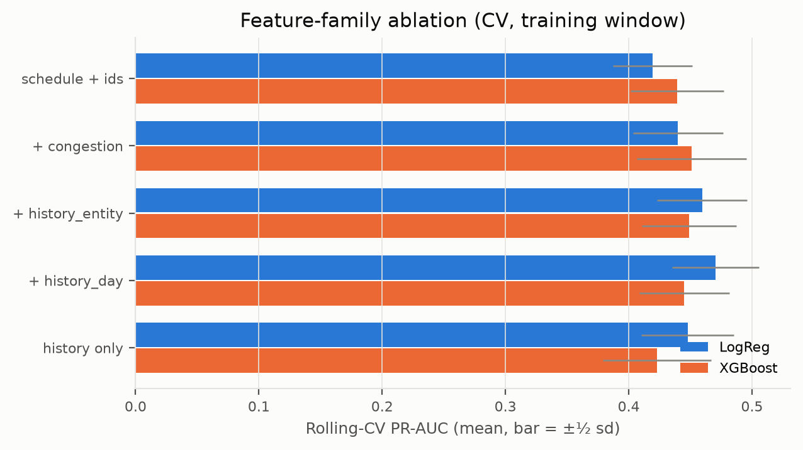
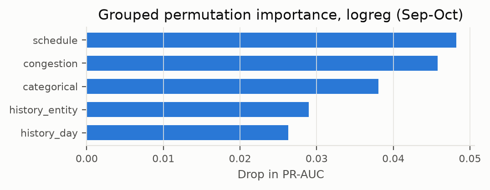
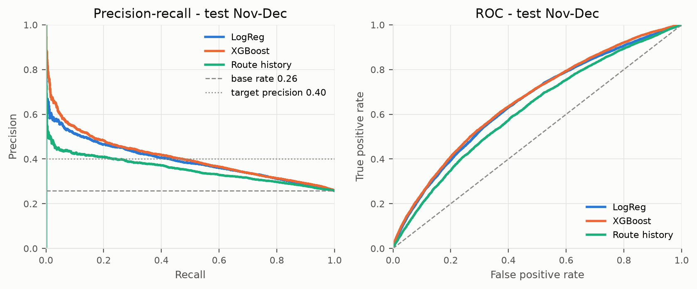
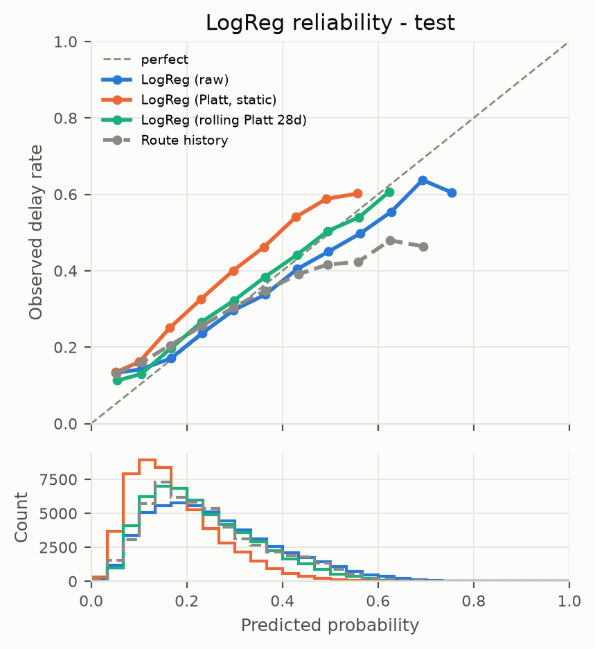
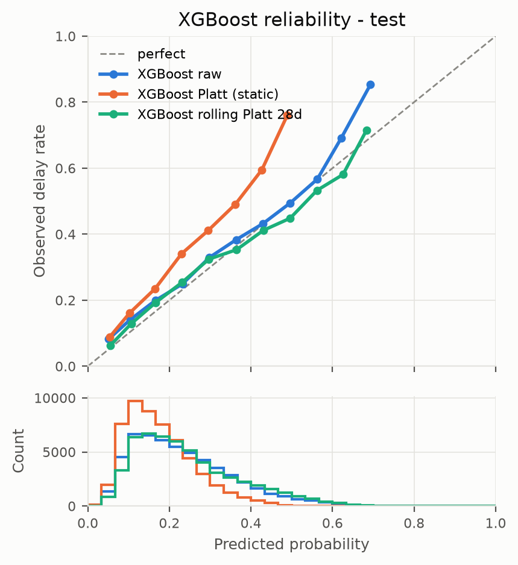
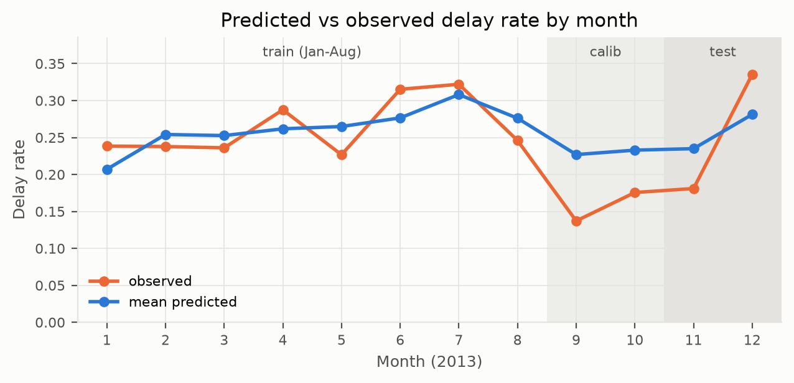
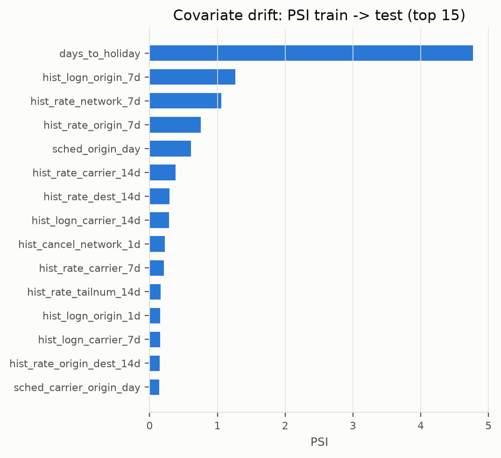
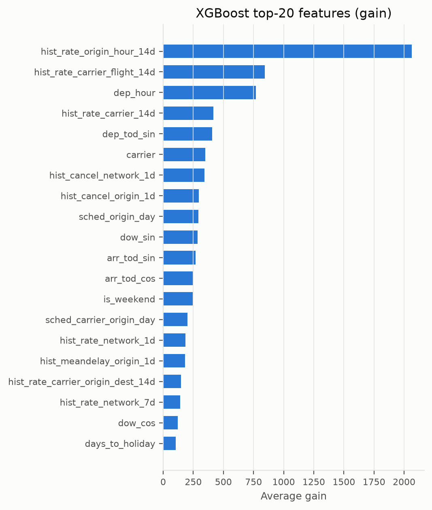

# 04 · Evaluation

> Summarises [04_evaluation.ipynb](../notebooks/04_evaluation.ipynb) (Parts A and B). All numbers come from `results/` or the executed notebook outputs.

Evidence is kept apart: **Part A** is what any decision rests on (CV / Sep–Oct); **Part B** is exploratory (test). See the [development protocol](development_protocol.md).

## Metric theory (notebook §1)

* **PR-AUC = average precision** (step-wise Σ (R_k − R_{k−1}) P_k, not the trapezoid); baseline = base rate. ROC-AUC ignores the base rate; PR matches what an ops desk sees under imbalance.
* **ECE** = Σ_b |B_b|/n · |ȳ_b − p̄_b|: a *biased* estimator (noise adds, grows with bins) and binning-dependent, so both **equal-width** (15 bins) and **equal-mass** ECE are reported next to the Brier score. It is a marginal check: the *prior* has a small ECE when the test base rate is near the training one (0.007 here), which says nothing about skill.
* **Platt / temperature scaling vs isotonic:** Platt = σ(a·logit p + b), 2 parameters, smooth; temperature scaling is its 1-parameter case; isotonic is a monotone step function (flexible, data-hungry). All assume calibration data resemble deployment data.
* **`oracle_recall@p`:** best recall at precision ≥ p with the threshold tuned **on the evaluated labels**. A point on the PR curve for **comparing models only**, never an operating result.
* **Day-block bootstrap:** whole days are resampled (flights within a day are correlated); model differences are paired on the same days.

# Part A · Evidence used for selection (CV / Sep–Oct)

### A.1 Final model: rolling-CV PR-AUC as deployed (with references)

| model | calibration | cv_pr_auc_mean | cv_pr_auc_std |
|---|---|---|---|
| Prior (base rate) | none | 0.2775 | 0.0483 |
| Route history | none | 0.3476 | 0.0601 |
| LogReg (as deployed) | raw | 0.4705 | 0.0706 |
| XGBoost (as deployed, fixed trees) | raw | 0.4450 | 0.0729 |
| XGBoost (in-fold early stopping, optimistic; not used) | raw | 0.4754 | 0.0673 |

**LogReg and XGBoost are not statistically distinguished** (CV 0.4705 vs 0.4450, fold sd about 0.07; test CI [-0.010, +0.041]). The final-model choice rests on the **rule declared before test**. Both learned models clearly beat Route history (0.3476) and the prior (0.2775).

### A.2 History settings, decision clock, month (CV)

m, window and C are tuned jointly: the CV-best pair is **m = 5, window = @L@, C = @C@ (unchanged by the joint re-tuning)**; the 20:00 clock scores 0.4705 vs 0.4587 (2-day lag) and 0.4812 (leaky 24:00 clock). No month feature (LogReg 0.4705 vs 0.4686 with month). Details: [02](02_feature_engineering.md).

### A.3 Calibration rule, decided on Sep–Oct

Rule (fixed before test): fit Platt and isotonic on **September**, check ECE on **October**, keep **raw** unless the best recalibrator wins by more than **0.005**; then refit on Sep–Oct.

| model | calibrator | check_ece | check_ece_equal_mass | check_brier | gain_vs_raw |
|---|---|---|---|---|---|
| logreg | raw | 0.0609 | 0.0614 | 0.1404 | 0.0000 |
| logreg | platt | 0.0349 | 0.0349 | 0.1378 | 0.0260 |
| logreg | isotonic | 0.0362 | 0.0356 | 0.1386 | 0.0247 |
| xgboost | raw | 0.0220 | 0.0245 | 0.1386 | 0.0000 |
| xgboost | platt | 0.0465 | 0.0465 | 0.1411 | -0.0245 |
| xgboost | isotonic | 0.0468 | 0.0468 | 0.1413 | -0.0248 |

Outcome: **LogReg → Platt (rule-selected)** (October ECE gain 0.026); **XGBoost → raw (rule-selected)**. Causal **rolling Platt** (refit daily on the trailing N = 28 days of known outcomes; N fixed a priori, 14/56 reported as sensitivity only) is the adaptive alternative, evaluated in Part B.

### A.4 Ablation: CV evidence

| model | calibration | step | cv_gain_mean | cv_folds_improved |
|---|---|---|---|---|
| LogReg | raw | + congestion | 0.0209 | 4/4 |
| LogReg | raw | + history_entity | 0.0195 | 4/4 |
| LogReg | raw | + history_day | 0.0110 | 3/4 |
| XGBoost | raw | + congestion | 0.0118 | 3/4 |
| XGBoost | raw | + history_entity | -0.0019 | 2/4 |
| XGBoost | raw | + history_day | -0.0040 | 3/4 |

LogReg (raw): congestion +0.021 (4/4 folds), entity history +0.020 (4/4 folds), day-level history +0.011 (3/4 folds). XGBoost (raw): congestion +0.012 (3/4 folds), entity history -0.002 (2/4 folds), day-level history -0.004 (3/4 folds). No claim rests on XGBoost's ablation (CV and test disagree for entity history).

| model | calibration | features | n_features | cv_pr_auc_mean | cv_pr_auc_std |
|---|---|---|---|---|---|
| Prior (base rate) | none | (baseline) | 0 | 0.2775 | 0.0483 |
| Route history | none (smoothed rate) | (baseline) | 0 | 0.3476 | 0.0601 |
| LogReg | raw | schedule + ids | 13 | 0.4191 | 0.0643 |
| LogReg | raw | + congestion | 20 | 0.4400 | 0.0729 |
| LogReg | raw | + history_entity | 38 | 0.4595 | 0.0727 |
| LogReg | raw | + history_day | 45 | 0.4705 | 0.0706 |
| LogReg | raw | history only | 25 | 0.4478 | 0.0753 |
| XGBoost | raw | schedule + ids | 13 | 0.4391 | 0.0754 |
| XGBoost | raw | + congestion | 20 | 0.4509 | 0.0886 |
| XGBoost | raw | + history_entity | 38 | 0.4490 | 0.0769 |
| XGBoost | raw | + history_day | 45 | 0.4450 | 0.0729 |
| XGBoost | raw | history only | 25 | 0.4231 | 0.0879 |

### A.5 Grouped permutation importance (Sep–Oct)

| group | LogReg | XGBoost |
|---|---|---|
| categorical | 0.0376 | 0.0147 |
| congestion | 0.0464 | 0.0150 |
| history_day | 0.0261 | 0.0089 |
| history_entity | 0.0287 | 0.0178 |
| schedule | 0.0423 | 0.0537 |

LogReg: influence ranks congestion (0.046), schedule (0.042), categorical (0.038), history_entity (0.029), history_day (0.026). XGBoost: the ranking is schedule (0.054), history_entity (0.018), congestion (0.015), categorical (0.015), history_day (0.009).

# Part B · Exploratory test-set findings (ablation test diffs, calibration study, target sensitivity)

Test = Nov–Dec 2013. Nothing below chose anything; test numbers were visible during development, so small differences are exploratory.

## B.1 Pre-specified rules on test

### Headline test metrics: references, calibration variants, final model

| model | calibration | pr_auc | roc_auc | brier | ece | ece_equal_mass | oracle_recall@p0.40 |
|---|---|---|---|---|---|---|---|
| Prior (base rate) | none | 0.258 | 0.500 | 0.192 | 0.007 | 0.084 | 0.000 |
| Route history | none (smoothed rate) | 0.353 | 0.621 | 0.187 | 0.037 | 0.038 | 0.244 |
| LogReg (raw) | raw | 0.394 | 0.654 | 0.181 | 0.019 | 0.022 | 0.430 |
| LogReg (Platt, rule-selected) | Platt (rule-selected) | 0.394 | 0.654 | 0.187 | 0.082 | 0.082 | 0.430 |
| LogReg (rolling Platt 28d) | rolling Platt 28d (causal) | 0.392 | 0.657 | 0.181 | 0.027 | 0.026 | 0.432 |
| XGBoost (raw, rule-selected) | raw (rule-selected) | 0.407 | 0.662 | 0.180 | 0.027 | 0.027 | 0.474 |
| XGBoost (rolling Platt 28d) | rolling Platt 28d (causal) | 0.396 | 0.659 | 0.180 | 0.024 | 0.023 | 0.416 |

`LogReg (Platt, rule-selected)` is the model as the pre-declared rule deploys it. Its ranking equals `LogReg (raw)` (Platt is monotone), but its calibration does not: **test ECE 0.082 (Platt, rule-selected) vs 0.019 (raw) vs 0.027 (rolling Platt 28d)**. **The static rule fails in December** (below). Both learned models beat both references on PR-AUC (0.394 LogReg, 0.407 XGBoost, 0.353 route history, 0.258 prior); the prior's low ECE (0.007; equal-mass 0.084) is not skill. `oracle_recall@p0.40` is a comparison metric only.

### November and December

| model | calibration | split | base_rate | pr_auc | roc_auc | brier | ece |
|---|---|---|---|---|---|---|---|
| Prior (base rate) | none | test_m11 | 0.181 | 0.181 | 0.500 | 0.155 | 0.084 |
| Route history | none (smoothed rate) | test_m11 | 0.181 | 0.221 | 0.560 | 0.149 | 0.035 |
| LogReg (raw) | raw | test_m11 | 0.181 | 0.291 | 0.655 | 0.145 | 0.055 |
| LogReg (Platt, rule-selected) | Platt (rule-selected) | test_m11 | 0.181 | 0.291 | 0.655 | 0.142 | 0.021 |
| LogReg (rolling Platt 28d) | rolling Platt 28d (causal) | test_m11 | 0.181 | 0.285 | 0.650 | 0.142 | 0.007 |
| XGBoost (raw, rule-selected) | raw (rule-selected) | test_m11 | 0.181 | 0.270 | 0.638 | 0.144 | 0.019 |
| XGBoost (rolling Platt 28d) | rolling Platt 28d (causal) | test_m11 | 0.181 | 0.261 | 0.631 | 0.144 | 0.013 |
| Prior (base rate) | none | test_m12 | 0.335 | 0.335 | 0.500 | 0.228 | 0.071 |
| Route history | none (smoothed rate) | test_m12 | 0.335 | 0.394 | 0.574 | 0.225 | 0.060 |
| LogReg (raw) | raw | test_m12 | 0.335 | 0.456 | 0.632 | 0.217 | 0.060 |
| LogReg (Platt, rule-selected) | Platt (rule-selected) | test_m12 | 0.335 | 0.456 | 0.632 | 0.233 | 0.142 |
| LogReg (rolling Platt 28d) | rolling Platt 28d (causal) | test_m12 | 0.335 | 0.431 | 0.603 | 0.220 | 0.050 |
| XGBoost (raw, rule-selected) | raw (rule-selected) | test_m12 | 0.335 | 0.468 | 0.635 | 0.216 | 0.064 |
| XGBoost (rolling Platt 28d) | rolling Platt 28d (causal) | test_m12 | 0.335 | 0.442 | 0.613 | 0.217 | 0.038 |

### LogReg vs XGBoost: day-block bootstrap (rule-selected variants)

| metric | XGBoost 95% CI | LogReg 95% CI | XGB − LR 95% CI |
|---|---|---|---|
| pr_auc | [0.348, 0.465] | [0.34, 0.45] | [-0.01, 0.041] |
| roc_auc | [0.633, 0.691] | [0.62, 0.682] | [-0.012, 0.029] |

XGBoost (raw, rule-selected) is ahead by +0.013 PR-AUC but the CI [-0.010, +0.041] includes 0: **statistically indistinguishable**, consistent with A.1.

### Operating policies (fixed before test)

* **Primary:** each day flag the top **10%** riskiest flights (a-priori capacity assumption; rank-based, so a monotone within-day recalibration cannot change it; ties broken by a seeded random draw).
* **Secondary:** a score threshold frozen on Sep–Oct to reach precision ≥ 0.4 (0.50 was unreachable on Sep–Oct, so it was lowered to 0.40).

| model | calibration | role | policy | flag_rate | precision | recall | lift | threshold |
|---|---|---|---|---|---|---|---|---|
| Prior (base rate) | none | primary | daily top 10% | 0.101 | 0.243 | 0.095 | 0.941 | – |
| Prior (base rate) | none | secondary | frozen thr for P>=0.4 (from Sep-Oct) | 0.000 | – | 0.000 | – | ∞ |
| Route history | none (smoothed rate) | primary | daily top 10% | 0.101 | 0.358 | 0.139 | 1.387 | – |
| Route history | none (smoothed rate) | secondary | frozen thr for P>=0.4 (from Sep-Oct) | 0.059 | 0.425 | 0.097 | 1.646 | 0.469 |
| LogReg (Platt, rule-selected) | Platt (rule-selected) | primary | daily top 10% | 0.101 | 0.444 | 0.173 | 1.720 | – |
| LogReg (Platt, rule-selected) | Platt (rule-selected) | secondary | frozen thr for P>=0.4 (from Sep-Oct) | 0.075 | 0.493 | 0.143 | 1.910 | 0.331 |
| XGBoost (raw, rule-selected) | raw (rule-selected) | primary | daily top 10% | 0.101 | 0.435 | 0.169 | 1.683 | – |
| XGBoost (raw, rule-selected) | raw (rule-selected) | secondary | frozen thr for P>=0.4 (from Sep-Oct) | 0.062 | 0.521 | 0.125 | 2.019 | 0.446 |

**Primary result (final model, `LogReg (Platt, rule-selected)`, test): precision 0.444, recall 0.173, lift 1.72×** versus 0.94 for the prior (random flagging) and 1.39 for route history; XGBoost (raw, rule-selected) 1.68. The frozen threshold flags 3.8% of flights in Sep–Oct but 7.5% in Nov–Dec for LogReg: a fixed probability cut-off does not transfer between seasons.

## B.2 Exploratory findings

### Calibration study: every variant, Nov and Dec separately

| model | calibration | ece_test | ece_test_m11 | ece_test_m12 | ece_equal_mass_test | brier_test | brier_test_m11 | brier_test_m12 |
|---|---|---|---|---|---|---|---|---|
| Prior (base rate) | none | 0.0066 | 0.0839 | 0.0706 | 0.0842 | 0.1916 | 0.1553 | 0.2279 |
| Route history | none (smoothed rate) | 0.0373 | 0.0352 | 0.0602 | 0.0380 | 0.1869 | 0.1492 | 0.2246 |
| LogReg (raw) | raw | 0.0190 | 0.0553 | 0.0595 | 0.0216 | 0.1811 | 0.1454 | 0.2168 |
| LogReg (Platt, static) | Platt (static, fit Sep-Oct) | 0.0815 | 0.0208 | 0.1421 | 0.0815 | 0.1872 | 0.1418 | 0.2326 |
| LogReg (isotonic, static) | isotonic (static, fit Sep-Oct) | 0.0817 | 0.0226 | 0.1416 | 0.0802 | 0.1873 | 0.1419 | 0.2327 |
| LogReg (rolling Platt 14d) | rolling Platt 14d (causal) | 0.0215 | 0.0110 | 0.0385 | 0.0230 | 0.1807 | 0.1431 | 0.2181 |
| LogReg (rolling Platt 28d) | rolling Platt 28d (causal) | 0.0269 | 0.0065 | 0.0499 | 0.0265 | 0.1809 | 0.1419 | 0.2199 |
| LogReg (rolling Platt 56d) | rolling Platt 56d (causal) | 0.0510 | 0.0135 | 0.0886 | 0.0510 | 0.1820 | 0.1416 | 0.2223 |
| XGBoost (raw) | raw | 0.0267 | 0.0191 | 0.0642 | 0.0266 | 0.1797 | 0.1435 | 0.2158 |
| XGBoost (Platt, static) | Platt (static, fit Sep-Oct) | 0.0812 | 0.0329 | 0.1309 | 0.0812 | 0.1864 | 0.1440 | 0.2286 |
| XGBoost (isotonic, static) | isotonic (static, fit Sep-Oct) | 0.0787 | 0.0341 | 0.1258 | 0.0787 | 0.1859 | 0.1443 | 0.2274 |
| XGBoost (rolling Platt 14d) | rolling Platt 14d (causal) | 0.0227 | 0.0125 | 0.0429 | 0.0231 | 0.1802 | 0.1440 | 0.2163 |
| XGBoost (rolling Platt 28d) | rolling Platt 28d (causal) | 0.0241 | 0.0130 | 0.0382 | 0.0231 | 0.1803 | 0.1438 | 0.2168 |
| XGBoost (rolling Platt 56d) | rolling Platt 56d (causal) | 0.0397 | 0.0220 | 0.0580 | 0.0397 | 0.1803 | 0.1433 | 0.2172 |

* The static Platt/isotonic calibration (fit on calm Sep–Oct, 15.7% late) is right for November (LogReg Platt ECE 0.021) and badly wrong for December (0.142, base rate 33.5%): **the static rule fails in December**.
* Raw scores are well calibrated overall (LogReg ECE 0.019) only because the training and test base rates are close: a coincidence of this split.
* **Rolling Platt (N = 28, a priori):** LogReg ECE 0.027 (Nov 0.007, Dec 0.05), XGBoost 0.024. N = 14: 0.021; N = 56: 0.051 (LogReg; reported only).

### Ablation: test differences (confirmation only)

| model | calibration | step | test_diff | test_diff_ci_lo | test_diff_ci_hi |
|---|---|---|---|---|---|
| LogReg | raw | + congestion | 0.0072 | -0.0092 | 0.0275 |
| LogReg | raw | + history_entity | 0.0324 | 0.0154 | 0.0493 |
| LogReg | raw | + history_day | 0.0091 | -0.0091 | 0.0268 |
| XGBoost | raw | + congestion | 0.0024 | -0.0101 | 0.0147 |
| XGBoost | raw | + history_entity | 0.0520 | 0.0263 | 0.0772 |
| XGBoost | raw | + history_day | 0.0096 | -0.0238 | 0.0454 |

LogReg: congestion +0.007 [-0.009, +0.027] (CI includes 0); entity history +0.032 [+0.015, +0.049] (CI excludes 0); day-level history +0.009 [-0.009, +0.027] (CI includes 0). XGBoost: congestion +0.002 [-0.010, +0.015] (CI includes 0); entity history +0.052 [+0.026, +0.077] (CI excludes 0); day-level history +0.010 [-0.024, +0.045] (CI includes 0).

### Target sensitivity (cancelled and diverted = delayed)

| target | model | calibration | n_test | base_rate | pr_auc | roc_auc | brier | ece | top10_precision | top10_recall | top10_lift | xgb_minus_lr_pr_auc_ci |
|---|---|---|---|---|---|---|---|---|---|---|---|---|
| arr_delay>=15 (main) | Prior (base rate) | none | 53991 | 0.258 | 0.258 | 0.500 | 0.192 | 0.007 | 0.243 | 0.095 | 0.941 | – |
| arr_delay>=15 (main) | Route history | none (smoothed rate) | 53991 | 0.258 | 0.353 | 0.621 | 0.187 | 0.037 | 0.358 | 0.139 | 1.387 | – |
| arr_delay>=15 (main) | LogReg (raw) | raw | 53991 | 0.258 | 0.394 | 0.654 | 0.181 | 0.019 | 0.444 | 0.173 | 1.720 | [-0.010, +0.041] |
| arr_delay>=15 (main) | XGBoost (raw) | raw | 53991 | 0.258 | 0.407 | 0.662 | 0.180 | 0.027 | 0.435 | 0.169 | 1.683 | [-0.010, +0.041] |
| arr_delay>=15 OR cancelled/diverted | Prior (base rate) | none | 55403 | 0.277 | 0.277 | 0.500 | 0.200 | 0.012 | 0.262 | 0.095 | 0.946 | – |
| arr_delay>=15 OR cancelled/diverted | Route history | none (smoothed rate) | 55403 | 0.277 | 0.374 | 0.621 | 0.196 | 0.047 | 0.377 | 0.137 | 1.359 | – |
| arr_delay>=15 OR cancelled/diverted | LogReg (raw) | raw | 55403 | 0.277 | 0.446 | 0.661 | 0.186 | 0.024 | 0.478 | 0.173 | 1.726 | [-0.013, +0.037] |
| arr_delay>=15 OR cancelled/diverted | XGBoost (raw) | raw | 55403 | 0.277 | 0.455 | 0.669 | 0.185 | 0.029 | 0.475 | 0.172 | 1.715 | [-0.013, +0.037] |

The base rate rises from 25.8% to 27.7%; conclusions hold: XGBoost vs LogReg CI [-0.013, +0.037] (includes 0), policy lift LogReg 1.73 / XGBoost 1.71 / prior 0.95; both learned models still beat both references.

### Covariate shift: PSI and adversarial validation

| feature | group | psi_calib | psi_test |
|---|---|---|---|
| days_to_holiday | schedule | 0.261 | 4.769 |
| hist_logn_origin_7d | history_entity | 2.269 | 1.265 |
| hist_rate_network_7d | history_day | 5.147 | 1.058 |
| hist_rate_origin_7d | history_entity | 3.433 | 0.755 |
| sched_origin_day | congestion | 2.056 | 0.610 |
| hist_rate_carrier_14d | history_entity | 2.631 | 0.383 |
| hist_rate_dest_14d | history_entity | 2.143 | 0.292 |
| hist_logn_carrier_14d | history_entity | 0.472 | 0.289 |
| hist_cancel_network_1d | history_day | 1.229 | 0.222 |
| hist_rate_carrier_7d | history_entity | 1.699 | 0.209 |

| comparison | features | n_features | adversarial_auc |
|---|---|---|---|
| train vs calib | all features | 45 | 1.000 |
| train vs calib | categorical | 3 | 0.562 |
| train vs calib | schedule | 10 | 0.785 |
| train vs calib | congestion | 7 | 0.983 |
| train vs calib | history_entity | 18 | 1.000 |
| train vs calib | history_day | 7 | 1.000 |
| train vs test | all features | 45 | 1.000 |
| train vs test | categorical | 3 | 0.562 |
| train vs test | schedule | 10 | 0.921 |
| train vs test | congestion | 7 | 0.963 |
| train vs test | history_entity | 18 | 0.998 |
| train vs test | history_day | 7 | 1.000 |

PSI: the largest shifts into Sep–Oct are hist_rate_network_7d, hist_rate_origin_7d, hist_rate_carrier_14d (history rates follow the season by design), and into Nov–Dec days_to_holiday, hist_logn_origin_7d, hist_rate_network_7d; `days_to_holiday` is the largest (PSI 4.8) because Thanksgiving, Christmas and New Year all fall in the test window. Adversarial AUC: **categorical** 0.56 (vs calib) / 0.56 (vs test); **schedule** 0.78 (vs calib) / 0.92 (vs test); **congestion** 0.98 (vs calib) / 0.96 (vs test); **history_entity** 1.00 (vs calib) / 1.00 (vs test); **history_day** 1.00 (vs calib) / 1.00 (vs test). The IDs (carrier, origin, destination) are nearly stable; schedule and congestion shift through season and holiday proximity; history separates the periods completely by design.

